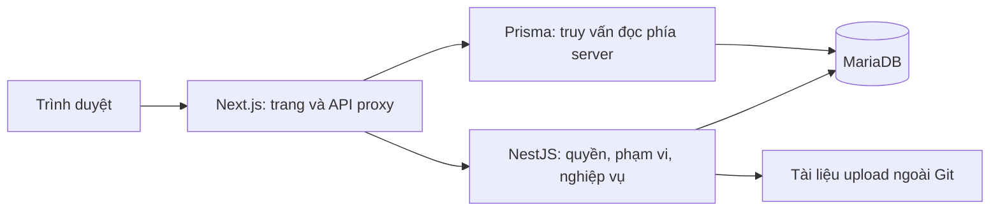

# Kiến trúc và liên kết dữ liệu

Frontend dùng cookie HttpOnly để giữ JWT; proxy chuyển bearer tới NestJS. Backend kiểm tra tài khoản/session, quyền chức năng và phạm vi trong SQL. Các route ghi phía frontend yêu cầu Origin hợp lệ; `APP_ORIGIN`/`TRUSTED_ORIGINS` xác định các origin công khai tin cậy khi có proxy. Không tin trực tiếp `X-Forwarded-Host` từ người gọi.

Quan hệ chính: ngành + bậc + đơn vị → CTĐT → phiên bản → hướng → nhóm/môn; lớp quản lý → phân công học viên theo hướng. Kết quả học tập gắn đúng phiên bản môn; danh sách học nối học viên, môn giảng dạy và học kỳ. Đề tài/bảo vệ và hồ sơ xét tốt nghiệp liên kết đúng lần phân công CTĐT.

Nguồn schema: [CSDL.sql](../03_SourceCode/backend/src/core/database/CSDL.sql), lịch sử thay đổi: [TypeORM migrations](../03_SourceCode/backend/src/core/database/migrations). File SQL gốc có dữ liệu minh họa và lệnh xóa database; không chạy chồng lên database bàn giao. Lệnh `db:bootstrap` chỉ tạo schema/reference trên database trống, bỏ dữ liệu MIT và tài khoản mẫu. Chạy migrations sau bootstrap.

Excel cập nhật điểm dùng snapshot có chữ ký, so sánh gốc/trong file/hiện tại, phát hiện xung đột cùng ô và lưu atomically. Mẫu cho bản ghi/luồng khác không được sử dụng thay thế. Nguồn AGU và phiên bản nội bộ có cơ chế đọc khác nhau; quyền ghi không dùng ngoại lệ đọc công khai.
